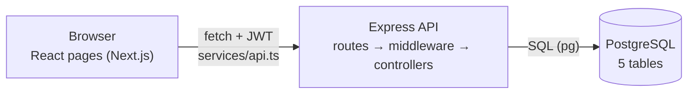
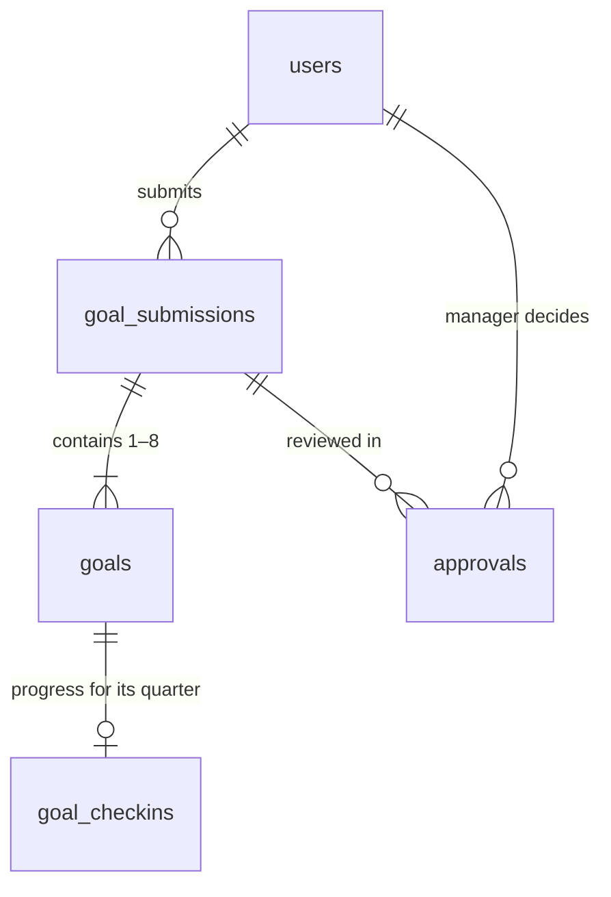
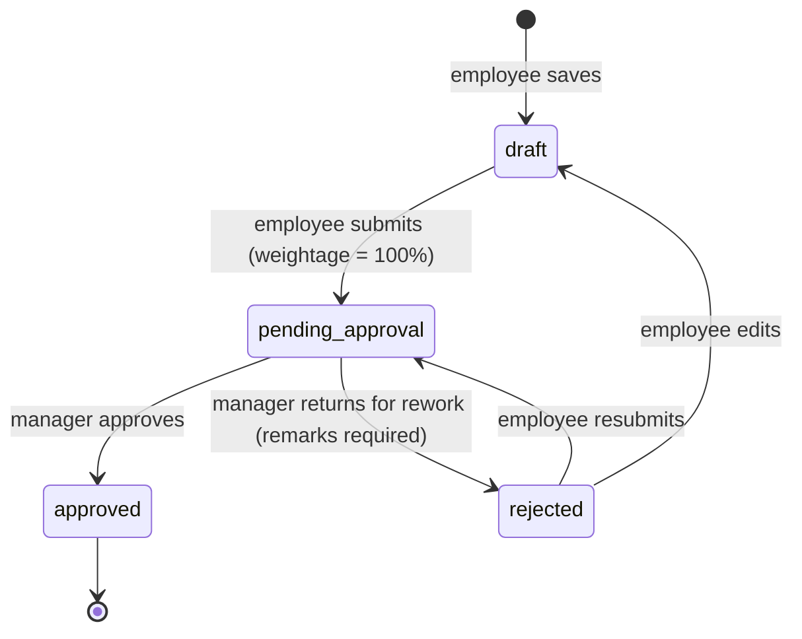

# PrimeHR – How It Works

## 1. The big picture

Three layers, each with one job:

1. **Frontend (React / Next.js)** — the screens. Every request to the server goes through one file, `services/api.ts`, which attaches the login token.
2. **Backend (Express)** — the rules. A request passes through
   `route` → `authenticate` (is the token valid?) → `authorize` (is this role allowed?) → `controller` (business rules + SQL).
3. **Database (PostgreSQL)** — the data, in 5 related tables.

## 2. Database – 5 tables

| Table | What one row is | Key columns |
|---|---|---|
| `users` | A person | `email` (unique), `password_hash` (bcrypt), `role` = employee / manager / admin |
| `goal_submissions` | One employee's goal plan for one period | `user_id`, `period` (e.g. "Q4 2026"), `status` — **unique per user + period** |
| `goals` | One goal inside a submission | `thrust_area`, `goal_title`, `target_value`, `weightage` |
| `approvals` | One manager decision (history is kept) | `submission_id`, `manager_id`, `approval_action`, `remarks` |
| `goal_checkins` | Progress on one goal for one quarter | `goal_id`, `quarter`, `actual_achievement`, `progress_status`, `blocker_note` — **unique per goal + quarter** |

**Why split submissions and goals?** Approval happens on the *whole plan*, not on single goals — the weightages must add up to 100% together. So the status lives on the submission, and goals hang off it.

## 3. The workflows

### Goal approval — a small state machine

Rules the **server** enforces (not just the form):

- Employees can only set `draft` or `pending_approval` — never `approved`.
- To submit: 1–8 goals, each ≥ 10% weightage, total exactly 100%.
- Approved or pending submissions can't be edited.
- A manager can't review their own goals, and remarks are required to return for rework.
- If a manager edits weightages, the total must still be 100% before approving.
- The approval runs in a **database transaction** with a row lock, so the status update, the approvals record and any edits either all save or none do — and two managers can't approve the same submission at once.

### Quarterly check-ins

Goals are planned for one period (e.g. "Q4 2026"), so each approved goal gets **one check-in, for its own quarter**. The Check-in page shows a tab for each period that has approved goals (newest first). The employee enters the actual achievement and a status (Not Started / On Track / Blocked / Completed). The server works out the quarter from the goal's period — the browser can't choose it. Saving again updates the same row (`INSERT … ON CONFLICT (goal_id, quarter) DO UPDATE`).

**Blockers:** if the employee picks **Blocked**, they must say why (up to 500 characters — the server enforces this). The reason is saved in `blocker_note`, shown to the manager under the red badge in Check-in Reviews, and listed in a **Blocked Goals** panel on the Manager Dashboard. Changing the status away from Blocked clears the reason.

**Score** = actual ÷ target × 100, capped at 100%. A goal with target 50 and actual 40 scores 80%.

### Reports

All dashboards are **calculated live with SQL** from the 5 tables (joins, `GROUP BY`, `COUNT`, `AVG`) — nothing is stored twice.

| Who | Report |
|---|---|
| Employee | Active / completed / pending goals, own score, recent check-ins |
| Manager | Plans waiting for approval (oldest first), blocked goals with reasons, team size, team score, performance distribution, goal status breakdown. "Team" means everyone except the manager themself |
| Admin | Org KPIs, status pie chart, quarter-on-quarter trend, approval turnaround, goals pending > 7 days, audit log, CSV export |

## 4. API

| Method | Endpoint | Who |
|---|---|---|
| POST | `/api/auth/register` · `/api/auth/login` | Public |
| GET · PUT | `/api/auth/me` · `/api/auth/password` | Signed in |
| GET · POST | `/api/goals` · `/api/goals/submit` | Signed in (own goals) |
| GET | `/api/approvals/pending` | Manager, Admin |
| PUT | `/api/approvals/submissions/:id/action` | Manager, Admin |
| GET · POST | `/api/checkins/my-checkins?period=Q4 2026` · `/api/checkins` | Signed in |
| GET | `/api/checkins/team?period=Q4 2026` | Manager, Admin |
| GET | `/api/reports/employee-dashboard` | Signed in |
| GET | `/api/reports/manager-dashboard` | Manager, Admin |
| GET | `/api/reports/admin-dashboard` · `/export` · `/audit-logs` | Admin |

## 5. Security

| Concern | How it's handled |
|---|---|
| Passwords | Hashed with **bcrypt**; never stored or returned in plain text |
| Login | Server issues a **JWT** (24 h). The browser sends it as `Authorization: Bearer …` |
| Permissions | `authorize([...roles])` middleware on every protected route. The user's role is re-read from the database on each request, so a role change applies immediately |
| Sign-up | Always creates an employee; roles are only changed by an admin |
| Brute force | Login limited to 10 attempts per 15 minutes |
| SQL injection | Every query uses **parameters** (`$1, $2`), never string-built SQL |
| Bad input | Validated on the client (Zod) **and** on the server |

## 6. Code map

| To understand… | Read |
|---|---|
| All tables | `backend/db/schema.sql` |
| Login + JWT | `backend/src/controllers/auth.controller.js`, `backend/src/middleware/auth.middleware.js` |
| Goal submission rules | `backend/src/controllers/goal.controller.js` |
| Approval transaction | `backend/src/controllers/approval.controller.js` |
| Dashboard SQL | `backend/src/controllers/reports.controller.js` |
| Goal form + Zod | `components/goals/goal-form.tsx`, `lib/validations/goal-schema.ts` |
| Route protection in the UI | `components/providers/auth-provider.tsx` |
| CSV export | `lib/export.ts` |
